# ha-mower-card

[](https://www.home-assistant.io/integrations/marketplace/)
[](https://github.com/juju35/ha-mower-card/actions/workflows/hacs.yml)
[](https://github.com/juju35/ha-mower-card/actions/workflows/validate.yml)
[](https://github.com/juju35/ha-mower-card/actions/workflows/lint.yml)
[](https://github.com/juju35/ha-mower-card/releases/latest)
[](https://github.com/juju35/ha-mower-card/blob/main/LICENSE)
[](https://buymeacoffee.com/julienstep9)

<p align="center">
  &nbsp;&nbsp;
  &nbsp;&nbsp;
  &nbsp;&nbsp;
  &nbsp;&nbsp;
  &nbsp;&nbsp;
  &nbsp;&nbsp;
  
</p>

Lovelace cards for Home Assistant to monitor and control robot lawn mowers from **[Husqvarna](https://www.husqvarna.com)** (Automower), **[Worx](https://www.worx.com)** (Landroid, also Kress and Landxcape), **[Ecovacs](https://www.ecovacs.com)** (GOAT), **[Mammotion](https://mammotion.com)** (Luba, Yuka), **[ZCS](https://www.zcsrobotics.com)** (Ambrogio, Techline, Wiper), **[Bosch](https://www.bosch-garden.com)** (Indego) and **[Gardena](https://www.gardena.com)** (Sileno) — and any other integration that provides a `lawn_mower` entity: status, battery, next start, work area, cutting height, errors, actions, options, maintenance, statistics and map at a glance.

The cards work on top of the integrations you already use — [Husqvarna Automower](https://www.home-assistant.io/integrations/husqvarna_automower/), [Ecovacs](https://www.home-assistant.io/integrations/ecovacs/), [Landroid Cloud](https://github.com/MTrab/landroid_cloud), [Mammotion](https://github.com/mikey0000/Mammotion-HA), [ZCS Mower](https://github.com/ufozone/ha-zcs-mower), [Bosch Indego](https://github.com/jm-73/indego), [Gardena Smart System](https://github.com/py-smart-gardena/hass-gardena-smart-system)… Entities are **discovered automatically** from the Home Assistant registries: you don't pick them one by one, and it works whatever your Home Assistant language or entity ids. The logo, the button color and the drawn picture follow the brand of each mower.

[](https://my.home-assistant.io/redirect/marketplace_repository/?owner=juju35&repository=ha-mower-card&category=plugin)

|  Husqvarna Automower |  Worx Landroid |  Ecovacs GOAT |
|---|---|---|
|  | 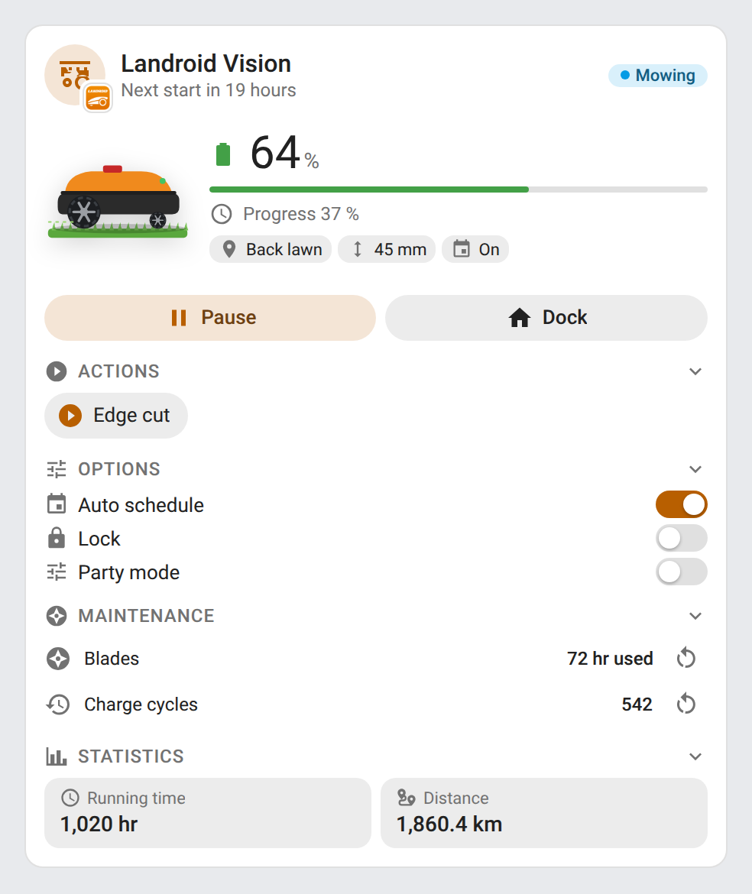 | 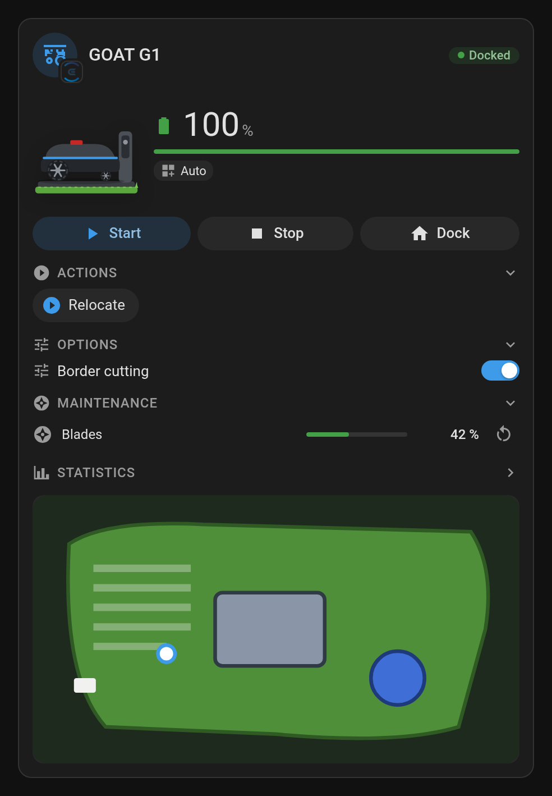 |
| 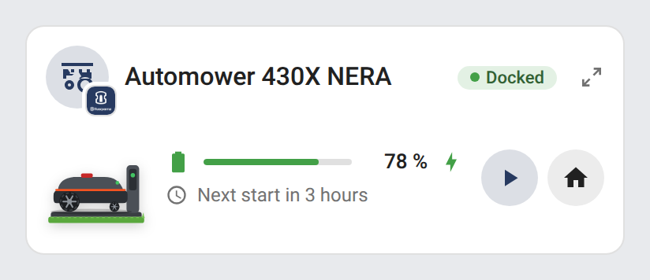 | 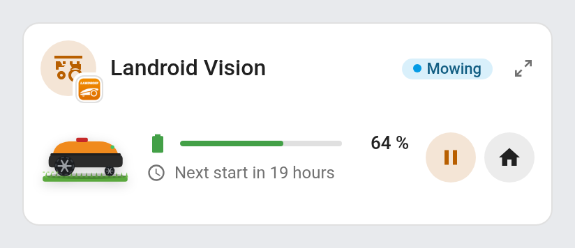 | 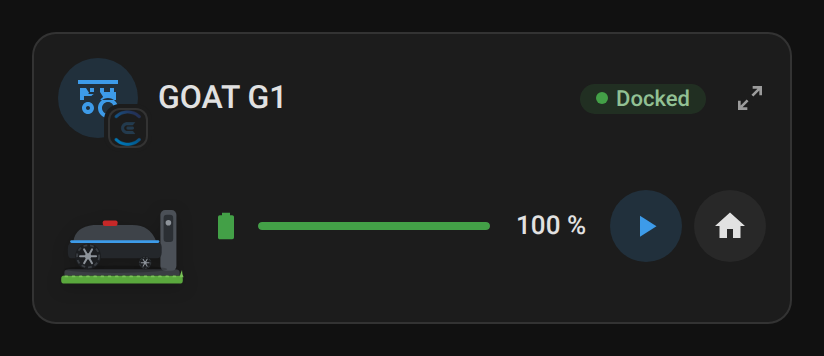 |

|  Mammotion |  Bosch Indego |
|---|---|
| 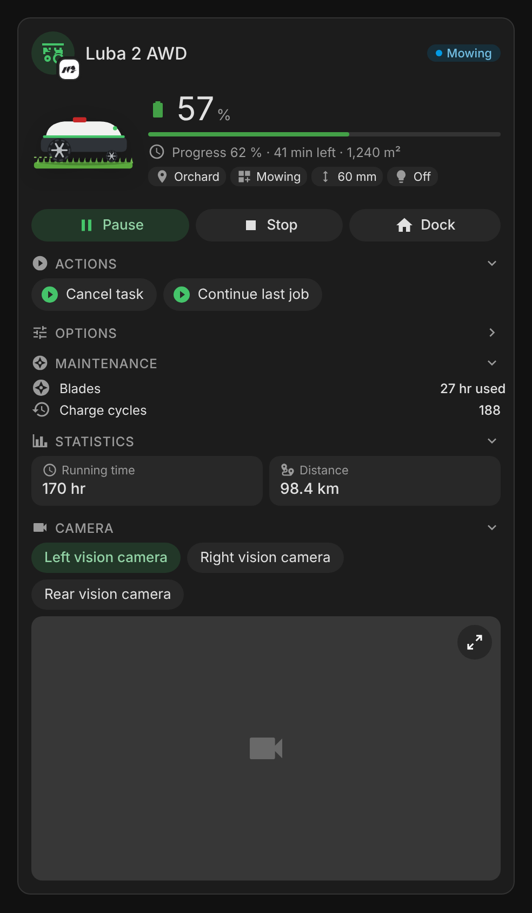 | 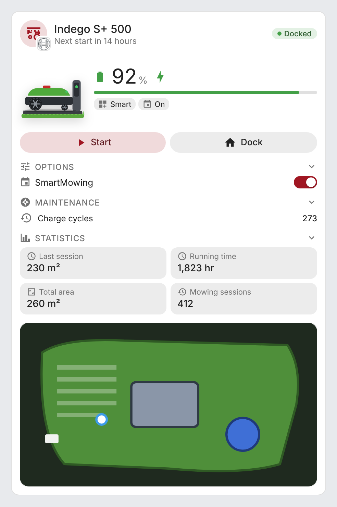 |
| 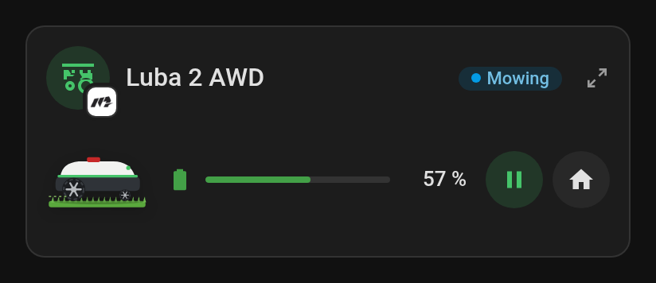 | 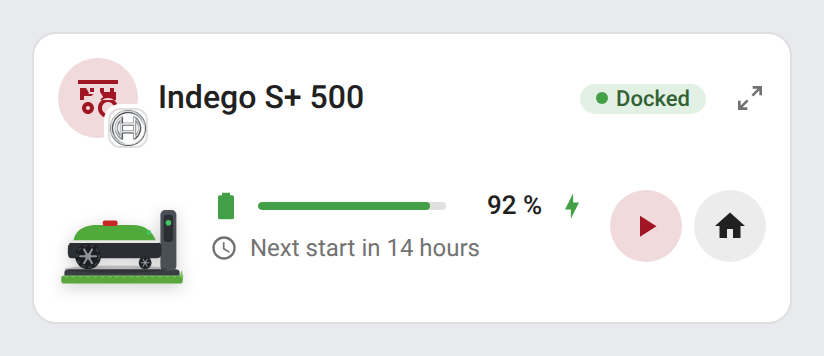 |

## Features

- Two cards: a full **Mower Card** (`custom:mower-card`) and a compact **Mower Mini Card** (`custom:mower-mini-card`)
- Any robot lawn mower exposed as a `lawn_mower` entity, several devices supported; the other devices of the same integrations (Ecovacs vacuums, Gardena valves…) are skipped
- Drawn mower picture in the brand's colors, animated by what the mower is doing (mowing, returning to the station, charging, error, rain delay), or your own picture
- Header icon of the robot mower with the brand logo as a badge, opening the brand's site, and buttons in the brand's color, readable in the light and dark themes
- Battery (sensor, or the mower's `battery_level` attribute) with the charging bolt, status, next scheduled start or last completed session, progress, time left and area of the current session
- Mower settings as tags: work area or zone, mode, cutting height, headlights, schedule on or off; why an Automower stays parked (week schedule, frost, daily limit…)
- Errors (error sensor, alert, stuck), rain detected and rain delay remaining
- Start / pause, stop (when the integration supports it) and dock buttons, following the entity's `supported_features`
- Actions: the buttons of the integration (edge cut, confirm error, relocate, continue last job…) as one-tap buttons with a confirmation
- Options: the switches of the integration (schedule, party mode, lock, stay-out zones, border cutting…) as toggles
- Maintenance: blade usage time or remaining life, battery charge cycles, collisions, with a reset button (with confirmation) when the integration provides one
- Statistics: last session, mowing, running, charging and searching time, distance, total area, number of sessions
- Live camera of the mower (Mammotion Luba / Yuka vision cameras, or any camera entity with `camera_entity`), played by Home Assistant's own player in a section folded by default: the stream only runs while the section is unfolded and the card visible, one tab per camera
- Map of the garden while the mower works (or always, or never), from the integration's image entity or picture-only camera (Ecovacs GOAT, Bosch Indego) or any entity of yours (`map_entity`)
- Collapsible sections (camera and statistics folded by default)
- Sections view: the full card takes 12 columns by default and at least 9, the mini card 6; narrow widths get their own layout (see [Screenshots](#screenshots))
- Command buttons disabled while the mower is unavailable
- Detail button on the mini card (top right): it switches the mini card to the full card's content and back; a click anywhere outside the card brings the compact view back
- Click any value to open its Home Assistant history (more-info dialog)
- Visual editor in the dashboard UI for both cards (no YAML needed)
- Light and dark mode, English, French, German, Spanish, Serbian (Cyrillic and Latin), Italian, Dutch, European Portuguese, Polish, Romanian, Danish, Swedish, Bulgarian, Russian, Ukrainian, Hungarian, Slovak, Czech, Slovenian, Latvian and Greek
- Single file, no external dependency, the logos and pictures are embedded

## Supported integrations

| Integration | Brands | What the cards show |
|---|---|---|
|  [Husqvarna Automower](https://www.home-assistant.io/integrations/husqvarna_automower/) (core) | Husqvarna Automower | Status, battery and charging, next start, restricted reason, mode, work area and its progress, cutting height, headlights, errors, controls, confirm error, schedule and stay-out zone switches, blade usage time with reset, charge cycles, collisions, totals (mowing, running, charging, searching time, distance) |
|  [Landroid Cloud](https://github.com/MTrab/landroid_cloud) (custom) | Worx Landroid, Kress, Landxcape, Ferrex | Status (edge cut, zoning, rain delay…), battery and charging, next schedule, daily progress, zone, cutting height, errors, rain sensor and rain delay, controls, edge cut, schedule / party mode / lock switches, blade time and charge cycles with reset, running time and distance |
|  [Ecovacs](https://www.home-assistant.io/integrations/ecovacs/) (core) | Ecovacs GOAT | Status, battery, errors, work mode, controls (stop included), relocate, border cutting switch, blade life in % with reset, last session, totals (area, mowing time, sessions), **map** |
|  [Mammotion](https://github.com/mikey0000/Mammotion-HA) (custom) | Mammotion Luba, Yuka | Status, battery and charging, mode, work area, progress, time left, area, blade height, errors, rain, controls (stop included), actions (continue last job, cancel task…), switches, blade time, charge cycles, running time and distance, **live vision cameras** |
|  [ZCS Mower](https://github.com/ufozone/ha-zcs-mower) (custom) | Ambrogio, Techline, Wiper | Status, battery, error, controls, actions (work now, charge now, border cut, wake up, trace position) |
|  [Bosch Indego](https://github.com/jm-73/indego) (custom) | Bosch Indego | Status, battery and charging, lawn mowed in % and m², last completed, next mow, mowing mode, alert and mower stuck, controls, SmartMowing switch, runtime, garden size, sessions, charge cycles, **map** (its camera entity) |
|  [Gardena Smart System](https://github.com/py-smart-gardena/hass-gardena-smart-system) (custom) | Gardena Sileno | Status, battery, error, controls, operating hours |
| Any other | — | Status, battery (sensor with the `battery` device class or `battery_level` attribute), charging and rain binary sensors by their device class, controls, buttons as actions, switches as options, streaming cameras in the camera section, image or picture-only camera as map |

Details in [Integrations](#integrations).

## Prerequisites

Home Assistant 2024.8 or later, with at least one integration providing a `lawn_mower` entity configured.

## Installation

### Via the Marketplace (recommended)

Click the button below to add the repository directly:

[](https://my.home-assistant.io/redirect/marketplace_repository/?owner=juju35&repository=ha-mower-card&category=plugin)

Then click **Install**, and reload your browser when the Marketplace asks you to.

Or manually:

1. Open **Settings → Marketplace → Add from link** (top right; this needs a GitHub account connected)
2. Add `https://github.com/juju35/ha-mower-card` — Type: **Dashboard**
3. Open **Mower Card** and click **Install**
4. Clear your browser cache and refresh

### Manual

1. Download `mower-card.js` from the [latest release](https://github.com/juju35/ha-mower-card/releases/latest)
2. Copy it to `/config/www/mower-card.js`
3. Go to **Settings → Dashboards → ⋮ → Resources** → Add resource:
   - URL: `/local/mower-card.js`
   - Type: **JavaScript Module**
4. Clear your browser cache and refresh

## Configuration

### Card types

| Card | Type |
|---|---|
| Mower Card | `custom:mower-card` |
| Mower Mini Card | `custom:mower-mini-card` |

### Visual editor

Both cards have a visual editor: add the card from the dashboard UI, pick the mower and the options. No YAML needed.

### Minimal

```yaml
type: custom:mower-card
```

```yaml
type: custom:mower-mini-card
```

Without `device`, the cards show the first lawn mower found.

### Full options

```yaml
type: custom:mower-card
device: Automower 430X NERA   # device name (as shown in Home Assistant) or device id
title: Garden mower           # optional, defaults to the device name
image: auto                   # auto (drawn, brand colors) | none | URL of your own picture
show_controls: true
show_settings: true           # work area, mode, cutting height, headlights, schedule tags
show_actions: true
show_options: true
show_maintenance: true
show_stats: true
show_camera: true             # live camera section (Mammotion vision cameras…)
show_map: mowing              # never | mowing | always
collapsed:                    # sections folded by default
  - camera
  - stats
map_entity: image.goat_g1_map # optional, a camera or image entity
camera_entity: camera.garden  # optional, replaces the cameras of the device
language: en                  # optional, defaults to the Home Assistant language
```

```yaml
type: custom:mower-mini-card
device: Automower 430X NERA
show_controls: true
zoom: true                    # detail button at the top right
```

### Options reference

| Option | Card | Default | Description |
|---|---|---|---|
| `device` | both | First lawn mower | Device to display: its name (as shown in Home Assistant) or its device id (set by the visual editor) |
| `title` | both | Device name | Card title |
| `image` | both | `auto` | Device picture: `auto` (drawn in the brand's colors, animated), `none`, or the URL of your own picture (e.g. `/local/my-mower.png`) |
| `show_controls` | both | `true` | Start / pause, stop and dock buttons, action buttons, option toggles and maintenance reset buttons |
| `zoom` | mini | `true` | Detail button at the top right of the mini card: it shows the full card's content (with the same options, so `show_map`, `collapsed`… can be set on the mini card too) and switches back to the compact view; a click outside the card also brings the compact view back. `false` removes the button |
| `show_settings` | full | `true` | Mower settings tags: work area or zone, mode, cutting height, headlights, schedule on or off |
| `show_actions` | full | `true` | Actions section: the integration's buttons (edge cut, confirm error, relocate, continue last job…) |
| `show_options` | full | `true` | Options section: the integration's switches (schedule, party mode, lock, stay-out zones…) |
| `show_maintenance` | full | `true` | Maintenance: blades, charge cycles, collisions |
| `show_stats` | full | `true` | Statistics |
| `show_camera` | full | `true` | Camera section: the live cameras of the mower, one tab per camera, played by Home Assistant's own player (WebRTC, HLS or MJPEG). Folded by default: the stream only runs while the section is unfolded and the card is visible on screen, and stops when it is folded (a click outside the card folds it), scrolled away or in a hidden tab — a mower on a cellular connection meters its streaming time. The button on the picture opens the camera's dialog |
| `show_map` | full | `mowing` | Map of the garden: `mowing` (only while the mower works), `always` (or `true`) or `never` (or `false`) |
| `collapsed` | full | `[camera, stats]` | Sections folded by default, among `actions`, `options`, `maintenance`, `stats` and `camera` (`[]` to unfold everything). Click a section title (or Tab to it and press Enter or Space) to fold or unfold it |
| `map_entity` | full | — | Camera or image entity to show as the map instead of the integration's (Ecovacs GOAT map image, Bosch Indego camera) |
| `camera_entity` | full | — | Camera entity for the camera section, instead of the streaming cameras of the device (a garden camera pointed at the lawn, say) |
| `language` | both | Auto | Force language: `fr`, `en`, `de`, `es`, `sr`, `sr-Latn`, `it`, `nl`, `pt`, `pl`, `ro`, `da`, `sv`, `bg`, `ru`, `uk`, `hu`, `sk`, `cs`, `sl`, `lv` or `el` (auto-detects from HA settings) |

## Screenshots

### Animations

The picture animates to match what the mower is doing and settles back to a still card once it is idle. Each state plays its own animation, and every one of them honours `prefers-reduced-motion`.

While the mower works, it drives across the lawn, its wheels turn, the grass waves and clippings fly behind the blade deck:

| Light | Dark |
|---|---|
| 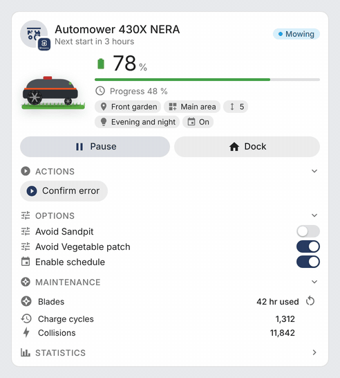 | 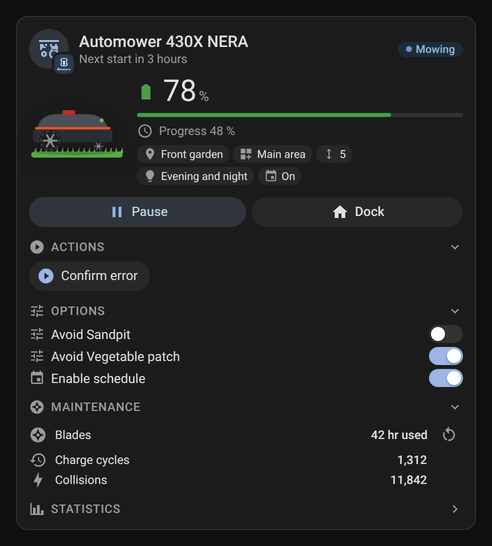 |

Heading back, it slides in from the side and settles on its charging station:

| Light | Dark |
|---|---|
| 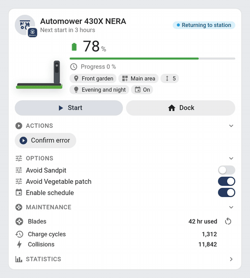 | 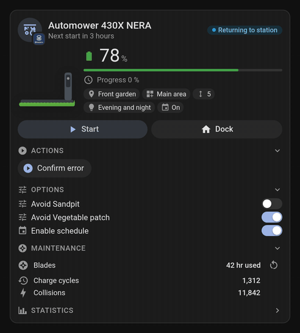 |

Docked and charging, the station light pulses green:

| Light | Dark |
|---|---|
| 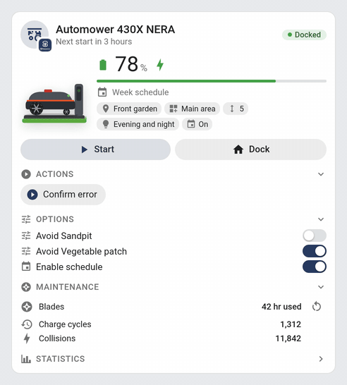 | 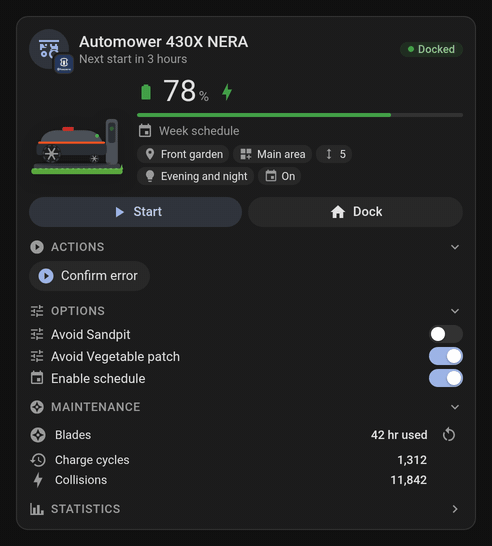 |

Stopped by an error, its light blinks red and the error is spelled out:

| Light | Dark |
|---|---|
| 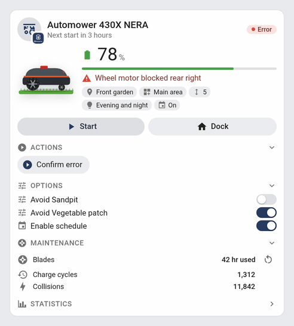 | 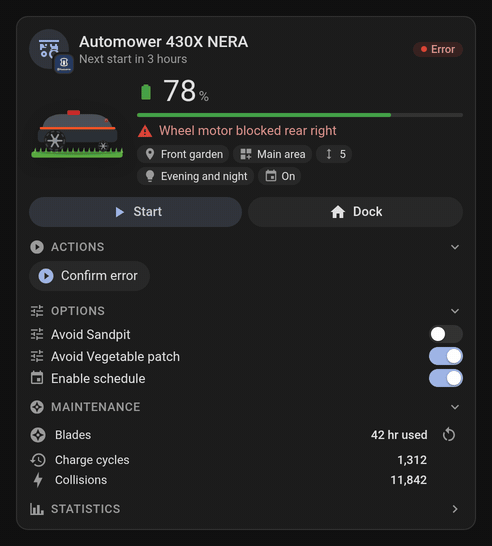 |

Waiting for the rain to stop (Landroid rain delay), drops fall over the lawn:

| Light | Dark |
|---|---|
| 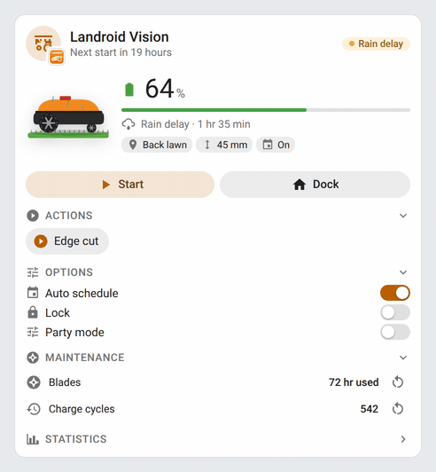 | 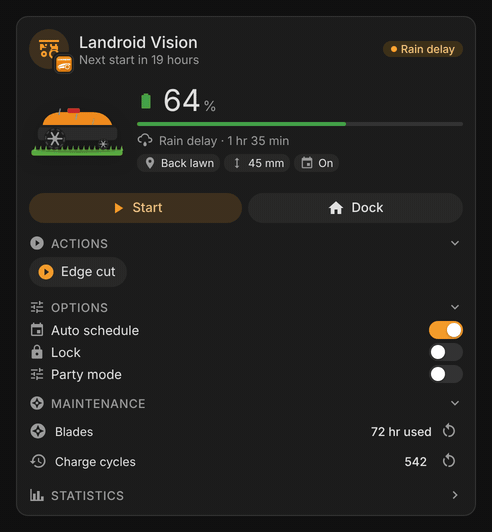 |

The mini card animates the same way:

| Light | Dark |
|---|---|
| 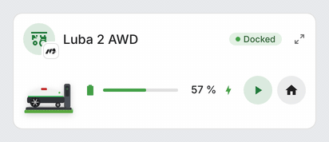 | 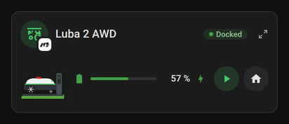 |

### Mini card detail button

The detail button at the top right switches the mini card to the full card's content; a click anywhere outside brings the compact view back:

| Light | Dark |
|---|---|
| 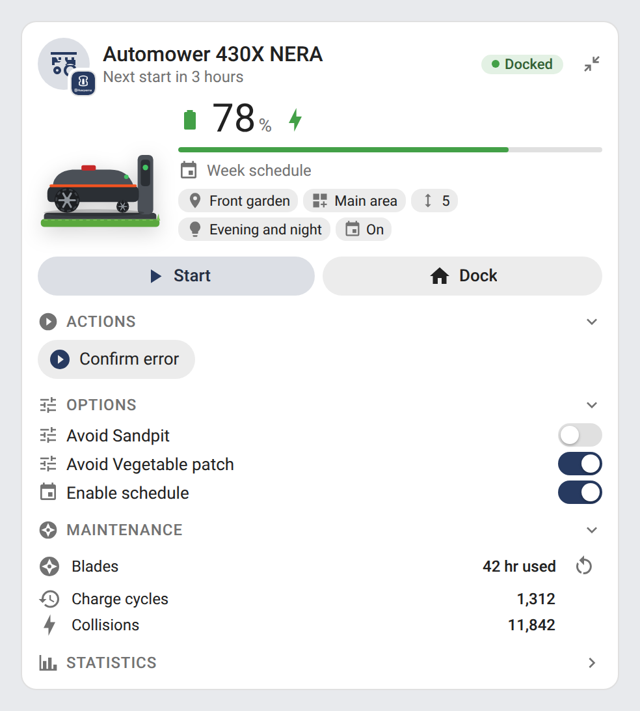 | 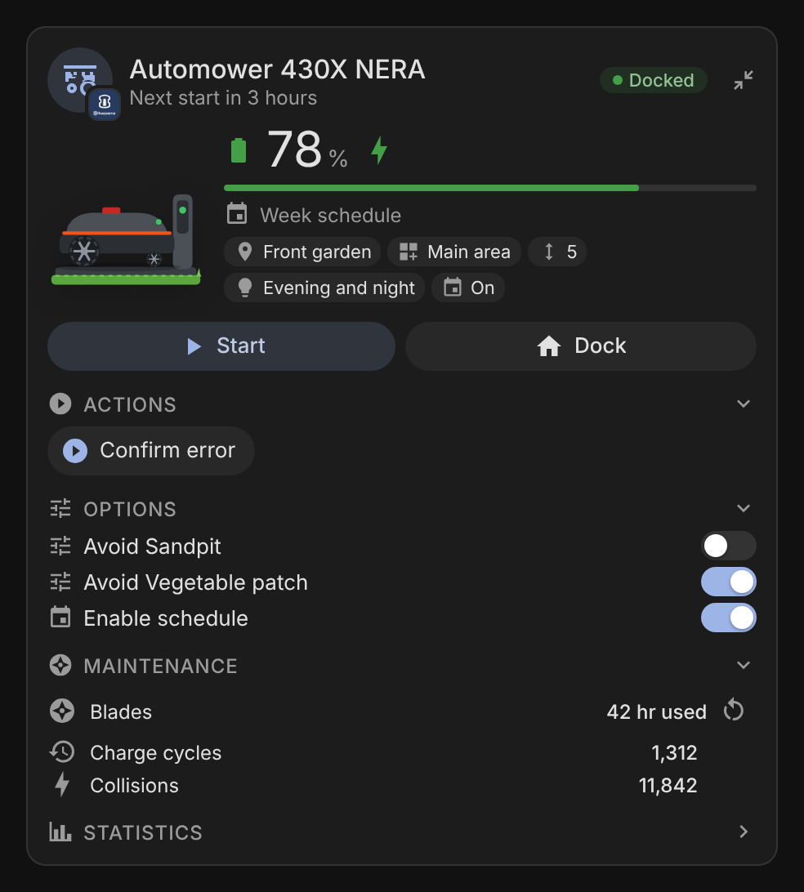 |

### Camera

The camera section with the three vision cameras of a Mammotion Luba (the player itself is Home Assistant's and loads once the card is on a dashboard; here, its placeholder):

| Light | Dark |
|---|---|
| 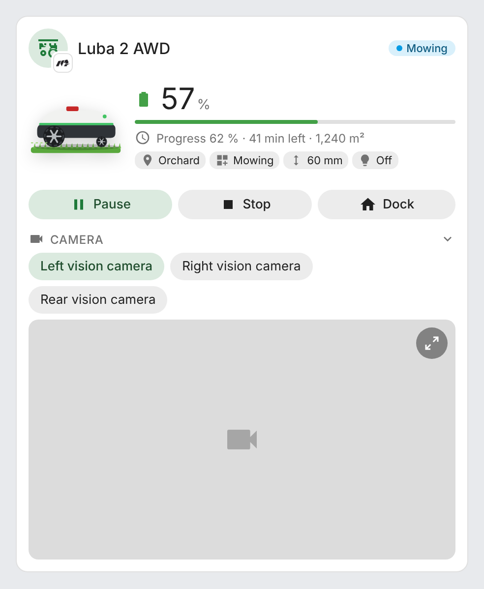 | 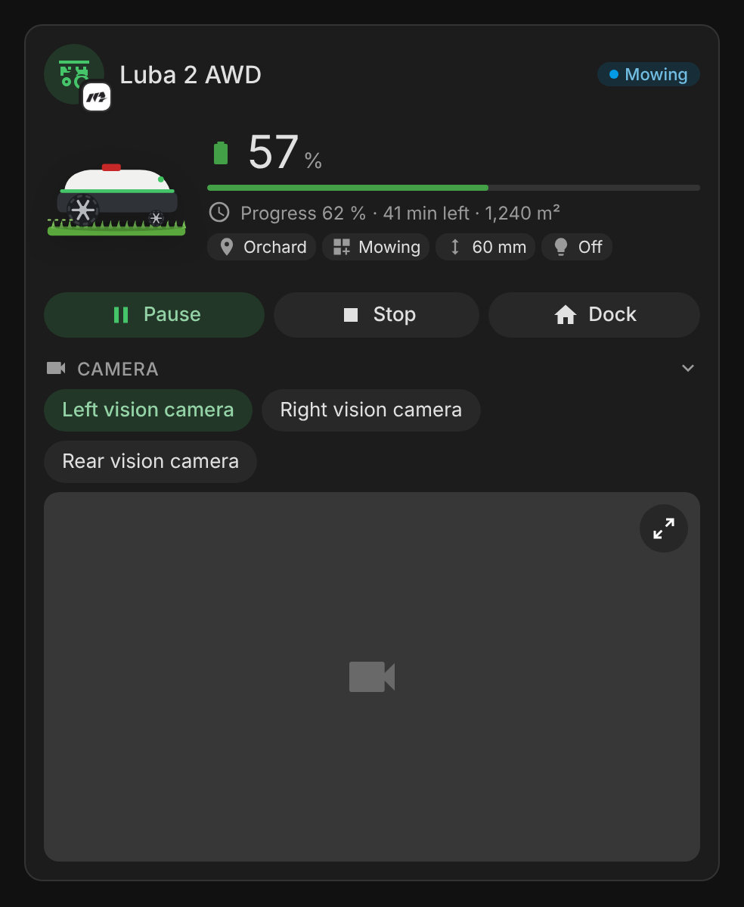 |

### Confirmation

Actions and counter resets ask for a confirmation at the top of the card:

| Light | Dark |
|---|---|
| 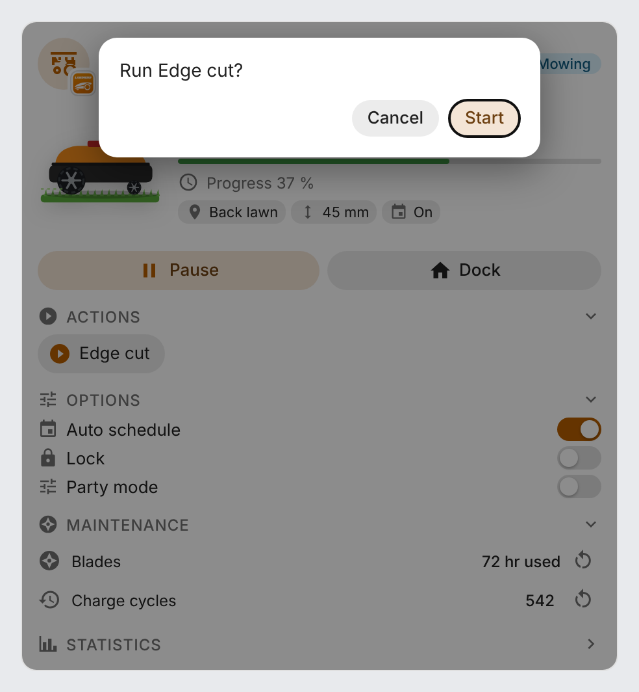 | 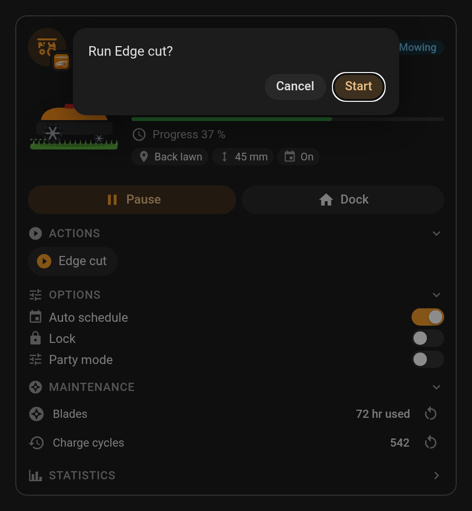 |

### Narrow widths

The full card at its minimum width (9 of 12 columns of a narrow Sections view) and the mini card at 6 columns of a phone's Sections view:

| Full card | Mini card |
|---|---|
| 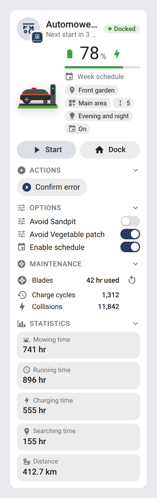 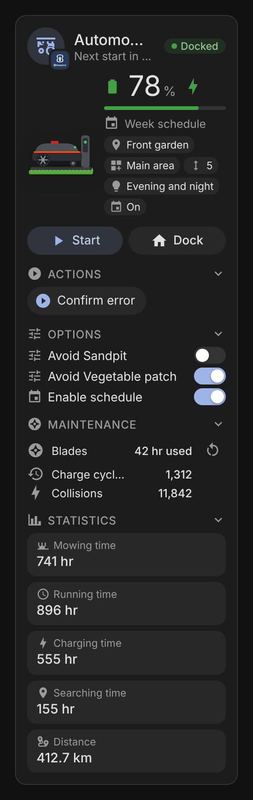 | 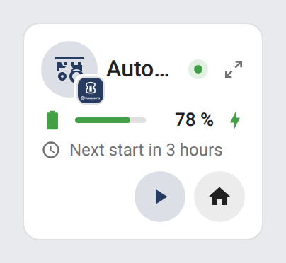 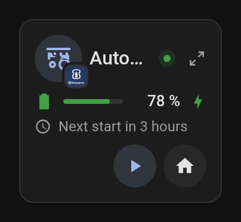 |

## How it works

### Integrations

The cards list every device that carries a `lawn_mower` entity, whatever the integration. The other entities of the device (sensors, binary sensors, buttons, switches, numbers, selects, images, cameras) are read by their `translation_key`, mapped per integration to a common set of names (battery, progress, next start, work area, blade time, charge cycles, total distance…). Integrations without translation keys (Bosch Indego, Gardena) are read by the end of their entity ids. Where no key matches, the cards fall back to device classes: `battery`, `battery_charging`, `moisture` (rain), `problem`.

For an integration the cards do not know, they still show the status and the controls of the `lawn_mower` entity, the battery, every button of the device as an action and every switch as an option, and an image or camera entity as the map.

### Controls

The Start / pause, Stop and Dock buttons follow the `supported_features` attribute of the `lawn_mower` entity (`START_MOWING`, `PAUSE`, `STOP`, `DOCK`) and call the `lawn_mower.start_mowing`, `lawn_mower.pause`, `lawn_mower.stop` and `lawn_mower.dock` actions. Actions press the integration's `button` entities and options toggle its `switch` entities (the requested state is shown until the integration reports it, up to 45 s). Pressing a button asks for a confirmation in the card.

### Camera and map

A camera entity of the device that reports a stream type (`frontend_stream_type`: WebRTC or HLS — the Mammotion vision cameras) goes to the camera section, played by Home Assistant's `ha-camera-stream` element (loaded on demand, like the picture cards). A camera without a stream only renders a picture (the Bosch Indego garden map) and is shown as the map, like the `image` entities (Ecovacs GOAT). `camera_entity` and `map_entity` override both choices.

### Brands

The integration a device comes from gives the logo of the header badge, the colors of the drawn picture and the accent color of the buttons, lighter in the dark theme. Unknown integrations get the mower icon alone and a green accent.

### States

The lawn mower activities of Home Assistant (`mowing`, `docked`, `paused`, `returning`, `error`, `idle`) and the extra states of Landroid Cloud (`starting`, `edgecut`, `zoning`, `searching_zone`, `escaped_digital_fence`, `rain_delayed`) are translated by the cards; any other state falls back to Home Assistant's own translation of the integration.

## Development

```bash
npm install
npm run build        # bundles src/mower-card.js + the logos of images/ into dist/mower-card.js
npm run check        # builds and checks the card (run in CI)
npm test             # unit tests (node --test)
npm run screenshots  # renders the cards (and one GIF per animated state, needs ffmpeg) with mock data into screenshots/
```

`dist/` is not committed: `npm run build` creates it locally, CI builds it on every push, and the release workflow attaches the built file to the release, which is where the Marketplace installs it from.

### Releasing

1. Bump `version` in `package.json`
2. Add a `## <version>` section at the top of [CHANGELOG.md](https://github.com/juju35/ha-mower-card/blob/main/CHANGELOG.md)
3. Push to `main`: the **Release** workflow builds the card, creates the tag and the GitHub release with the changelog section as notes, and attaches `mower-card.js`

## Translations

The cards auto-detect the language from your Home Assistant settings. Currently supported:

| Language | Code |
|---|---|
| English | `en` |
| Français | `fr` |
| Deutsch | `de` |
| Español | `es` |
| Српски | `sr` |
| Srpski (latinica) | `sr-Latn` |
| Italiano | `it` |
| Nederlands | `nl` |
| Português (European; also used for `pt-BR`) | `pt` |
| Polski | `pl` |
| Română | `ro` |
| Dansk | `da` |
| Svenska | `sv` |
| Български | `bg` |
| Русский | `ru` |
| Українська | `uk` |
| Magyar | `hu` |
| Slovenčina | `sk` |
| Čeština | `cs` |
| Slovenščina | `sl` |
| Latviešu | `lv` |
| Ελληνικά | `el` |

Contributions for additional languages are welcome!

## Credits

Husqvarna and Automower are trademarks of Husqvarna AB; Worx and Landroid of Positec; Ecovacs and GOAT of Ecovacs Robotics; Mammotion, Luba and Yuka of Mammotion; Ambrogio, Techline and Wiper of Zucchetti Centro Sistemi; Bosch and Indego of Robert Bosch GmbH; Gardena and Sileno of Husqvarna AB. The logos come from the [Home Assistant brands](https://github.com/home-assistant/brands) repository. This project is not affiliated with any of these companies.

## License

[MIT](https://github.com/juju35/ha-mower-card/blob/main/LICENSE)

## Support

If you find this project useful, you can support its development:

<a href="https://buymeacoffee.com/julienstep9"></a>
